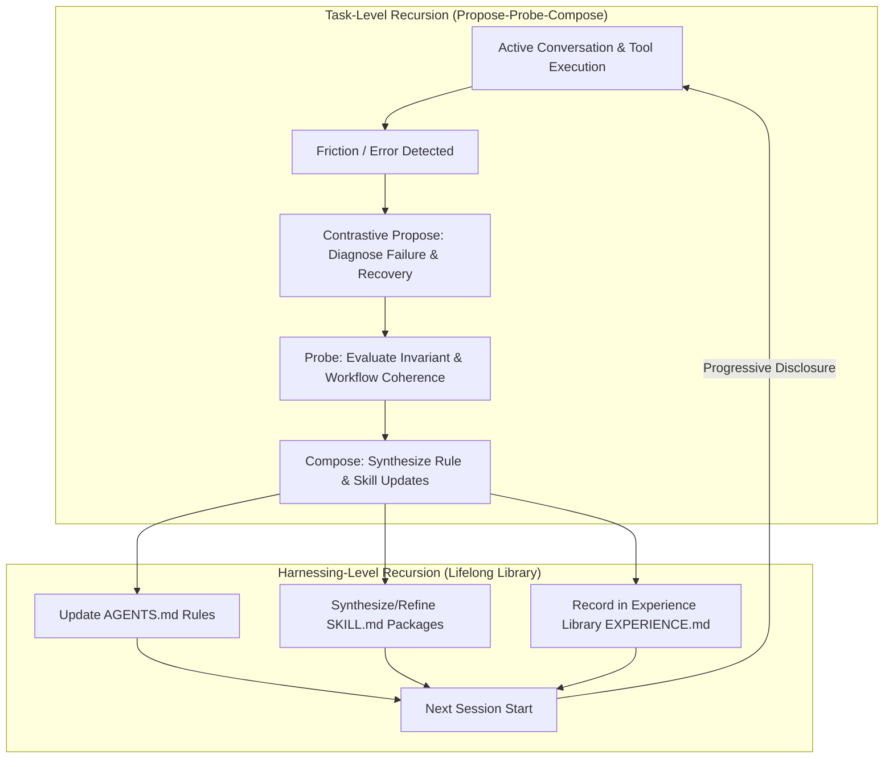

# Harness²: Recursive Agent Harnessing for Antigravity

[](https://opensource.org/licenses/Apache-2.0)
[](#)
[](https://github.com/google-research/harness2)

An autonomous self-improving harness plugin for Google Antigravity, based on Google Research's **Harness²** (*Recursive Agent Harnessing for an Open World*, arXiv:2610.14224).

Instead of fine-tuning model weights, Harness² freezes the core model and **recursively optimizes the operational execution harness** surrounding the agent.

---

## 🌟 Key Capabilities

- **🔄 Automatic `AGENTS.md` Evolution**: Continuously digests execution traces, extracts verified failure/recovery invariants, and updates `AGENTS.md` rules with deduplication and context-budget guarding.
- **📦 Autonomous Skill Synthesis & Refinement**: Identifies completed multi-step procedures and synthesizes full Antigravity skills (`skills/<name>/SKILL.md`) with valid YAML frontmatter and troubleshooting recipes. If a domain is revisited, it performs sequential refinement.
- **🚀 Elimination of Cold Starts**: Dynamically loads previously synthesized skills and evolved rules into subsequent sessions via progressive disclosure and `SessionStart` briefing hooks.
- **🧠 Cross-Session Memory & Experience Library**: Maintains an indexed SQLite store and an automatically synced, human-readable [`EXPERIENCE.md`](file:///C:/Users/Lenovo/.gemini/config/plugins/harness/memory/EXPERIENCE.md) cataloging lessons learned, tool failure contrasts, and skill reuse metrics.
- **⚡ Zero-Friction Hook Integration**: Uses native Antigravity lifecycle hooks (`SessionStart`, `PostToolUse`, `Stop`) to observe and improve without interrupting workflows.

---

## 🏛️ Architecture: Two Recursion Loops



### The 8 Harness Components in Antigravity

| Harness Component | Antigravity Implementation | Harness² Role |
| :--- | :--- | :--- |
| **1. Guardrails / Rules** | `rules/AGENTS.md`, workspace `AGENTS.md` | Auto-evolved behavioral invariants & platform quirks |
| **2. Skills** | `skills/<skill_name>/SKILL.md` | Reusable procedural recipes with progressive disclosure |
| **3. Memory** | SQLite DB & `memory/EXPERIENCE.md` | Persistent cross-session episodic & semantic memory |
| **4. Tool Guidance** | Contrastive pairs in rules | Avoidance of tool pitfalls & verified CLI flags |
| **5. Scripts** | `scripts/hook_runner.py` & CLI | Lifecycle orchestration scripts |
| **6. Subagents** | `agents/harness-curator.md` | Dedicated harness audit & curation agent |
| **7. Middleware / Hooks**| `hooks.json` | Intercepts `SessionStart`, `PostToolUse`, `Stop` |
| **8. System Prompt** | Dynamic injection on `SessionStart` | Real-time memory briefing of available skills |

---

## 🚀 Quick Start & CLI

The Harness plugin includes a comprehensive CLI tool:

```powershell
# 1. Inspect current status, active skills, and learning metrics
python -m harness status

# 2. View all synthesized skills
python -m harness skills

# 3. Inspect the full contents of a specific learned skill
python -m harness skills --name <skill-name>

# 4. Trigger manual self-improvement reflection on current workspace
python -m harness reflect --workspace

# 5. Sync the human-readable EXPERIENCE.md memory catalog
python -m harness sync
```

---

## 📁 Plugin File Structure

```text
~/.gemini/config/plugins/harness/
├── plugin.json                 # Antigravity plugin manifest
├── README.md                   # Plugin documentation
├── hooks.json                  # Antigravity lifecycle hooks configuration
├── assets/
│   └── logo.svg                # Plugin vector icon
├── rules/
│   └── AGENTS.md               # Standing global rules evolved by Harness
├── skills/
│   ├── harness-control/        # Built-in control skill
│   │   └── SKILL.md
│   ├── harness-reflector/      # Built-in reflection protocol skill
│   │   └── SKILL.md
│   └── <auto-generated-skills> # Skills synthesized across sessions
├── agents/
│   └── harness-curator.md      # Specialized curator subagent
├── scripts/
│   └── hook_runner.py          # Fast hook dispatcher
├── memory/
│   ├── harness_memory.db       # SQLite indexed experience store
│   └── EXPERIENCE.md           # Human-readable experience catalog
└── harness/                    # Core Python engine
    ├── core/
    │   ├── analyzer.py         # Transcript diagnosis & contrast extraction
    │   ├── agents_md_manager.py# Self-improving AGENTS.md evolution
    │   ├── skill_builder.py    # Autonomous skill synthesis & refinement
    │   ├── memory_store.py     # Persistent memory database
    │   ├── engine.py           # Propose-Probe-Compose orchestrator
    │   └── loader.py           # Session bootstrap injector
    ├── hooks.py                # Hook event handlers
    └── cli.py                  # CLI implementation
```

---

## 🧪 Testing & Verification

Run the comprehensive unit test suite:

```powershell
python -m unittest discover -s tests -p "test_*.py"
```

---

## 📜 License

Licensed under the Apache License, Version 2.0 (matching Google Research Harness²).
