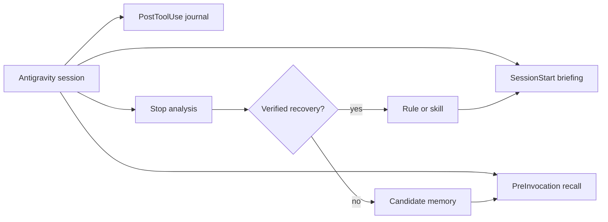

# Antigravity Harness (Harness²)

A self-improving harness plugin for Antigravity. It learns from normal sessions,
but only keeps lessons that were actually fixed.

[](https://github.com/Ai-assistant-KIRA/antigravity-harness/actions/workflows/ci.yml)
[](LICENSE)
[](pyproject.toml)

Harness² watches Antigravity sessions and turns verified failures and recoveries
into scoped `AGENTS.md` rules, reusable Agent Skills, and searchable
cross-session memory. It is local-first, written in Python with no third-party
dependencies, and stays quiet when it has nothing useful to add.

## Why it is strict

Most agent memory tools summarize everything. That produces noisy rules. Harness
is stricter: a failure only becomes a rule after a later action fixes it. If the
failure is never fixed, it stays in memory as a candidate and never reaches your
rules.

That one rule keeps the harness useful:

- a failed command that was never retried does not become advice;
- a transient network error does not become a permanent rule;
- a project-specific path does not leak into global rules;
- a skill you wrote by hand is never overwritten.

## What it does

- **Writes scoped rules.** Workspace lessons go to `<workspace>/AGENTS.md`.
  Environment and tooling lessons go to the plugin's global rules file. Harness
  only edits its own marked block.
- **Builds reusable skills.** A successful workflow with at least two distinct
  steps can become a `SKILL.md`. Generated skills are updated in place, with a
  size limit and no duplicate sections.
- **Remembers across sessions.** Lessons live in a local SQLite database with
  FTS5 search. Sessions are idempotent: replaying the same transcript does not
  double-count a lesson.
- **Recalls at the right time.** `SessionStart` injects a short briefing.
  `PreInvocation` searches for the current request or a new tool error and
  injects one compact message, deduplicated per conversation.

## Install

### Ask Antigravity to install it

Create a new Antigravity conversation and paste this:

> Install the Antigravity plugin from
> https://github.com/Ai-assistant-KIRA/antigravity-harness. Clone the repository
> to a temporary folder, read `INSTALL.md`, run `python install_plugin.py
> --dry-run`, then run `python install_plugin.py`. Do not use `--reset`. Run
> `harness doctor` when it finishes, then tell me to restart Antigravity.

The installer backs up an existing install, keeps your memory and rules, and
smoke-tests the Stop hook before it reports success.

### Manual install

```powershell
git clone https://github.com/Ai-assistant-KIRA/antigravity-harness.git
cd antigravity-harness
python install_plugin.py --dry-run
python install_plugin.py
```

Restart Antigravity after the installer finishes. The full guide, including
macOS/Linux, upgrade, rollback, and troubleshooting, is in
[INSTALL.md](INSTALL.md).

### Check the install

Use the wrapper that ships with the installed plugin.

```powershell
# Windows
& "$HOME\.gemini\config\plugins\harness\bin\harness.cmd" doctor
& "$HOME\.gemini\config\plugins\harness\bin\harness.cmd" status
```

```bash
# macOS / Linux
~/.gemini/config/plugins/harness/bin/harness doctor
~/.gemini/config/plugins/harness/bin/harness status
```

## How the loop works



| Event | What happens |
| :--- | :--- |
| `SessionStart` | Injects relevant skills, verified lessons, and rule sizes. |
| `PreInvocation` | Finds a matching lesson for the newest prompt or tool error. |
| `PostToolUse` | Records a redacted failure journal for diagnostics. Never blocks. |
| `Stop` | Analyses the transcript, promotes verified recoveries, and updates memory. |

A simple example:

1. `python -c "..."` fails with `SyntaxError`.
2. The next command writes the script to a file and runs it successfully.
3. Harness can promote that recovery into a rule.
4. If step 2 never happens, the failure stays a candidate.

## What gets written where

| Output | Location | Boundary |
| :--- | :--- | :--- |
| Workspace rules | `<workspace>/AGENTS.md` | Only the Harness-managed block |
| Global rules | `<plugin>/rules/AGENTS.md` | Environment and tooling only |
| Skills | `<workspace>/.agents/skills/<name>/SKILL.md` | Manual skills are never overwritten |
| Memory | `<plugin>/memory/harness_memory.db` | Local SQLite with FTS5 |
| Experience log | `<plugin>/memory/EXPERIENCE.md` | Generated; do not edit by hand |

The managed rule block is capped at 20 KB so it stays below Antigravity's 24 KB
per-file limit. Files outside the block are left alone.

## Safety and privacy

- **Verified only.** Unresolved failures are stored as candidates, not rules.
- **Scoped by default.** Project paths and commands do not enter global rules.
- **No overwrites.** User-authored skills and text outside the managed block are
  preserved.
- **Redaction.** Credentials are removed before anything is persisted. The
  extractor also refuses to promote authentication failures into rules.
- **Local-only.** The plugin does not call an LLM or send data to a service.
- **Injection checks.** Learned text is scanned for prompt-injection and
  exfiltration patterns before it is surfaced.

These are safety measures, not a security boundary. Review learned content before
you rely on it. The full threat model is in [docs/SECURITY.md](docs/SECURITY.md).

## CLI

The wrapper works from any directory. On Windows use `bin\harness.cmd`; on
macOS/Linux use `bin/harness`.

| Command | Purpose |
| :--- | :--- |
| `harness status` | Sessions, lessons, candidates, skills, and rule sizes |
| `harness status --effectiveness` | Rank lessons and skills by use and recurrence |
| `harness reflect` | Analyse a transcript and run the full cycle |
| `harness recall "error text"` | Search verified lessons and matching skills |
| `harness memory search "pytest"` | Search stored lessons |
| `harness skills list` | Inspect the learned skill library |
| `harness rules why "rule text"` | Show evidence and provenance for a rule |
| `harness rules conflicts` | Find opposing managed rules |
| `harness privacy audit` | Review retained data without dumping content |
| `harness doctor` | Read-only deployment and data health check |

## Configuration

Settings are optional. Put `harness.toml` (Python 3.11+) or `harness.json`
(Python 3.10 fallback) next to the installed plugin.

```toml
[rules]
max_bytes = 20000

[briefing]
max_chars = 7000
max_skills = 8
max_lessons = 5

[skills]
max_per_session = 2
min_quality = 0.55

[memory]
prune_days = 365
candidate_days = 30
max_lessons = 2000

[hooks]
stop_timeout = 90
post_tool_use_timeout = 5
```

Invalid values produce a warning and a safe default. They do not crash a hook.
Environment variables are documented in [INSTALL.md](INSTALL.md#configuration).

## Project layout

```text
antigravity-harness/
├── plugin.json              # Antigravity plugin manifest
├── hooks.json               # SessionStart, PreInvocation, PostToolUse, Stop
├── install_plugin.py        # Install, upgrade, uninstall, rollback
├── harness/
│   ├── cli.py
│   ├── hooks.py
│   └── core/                # Analyzer, memory, rules, skills, trust, settings
├── scripts/
│   ├── hook_runner.py
│   ├── harness_cli.py
│   └── stress_test.py
├── skills/                  # Bundled Agent Skills
├── rules/AGENTS.md          # Curated global rules
├── agents/                  # Curator subagent
├── docs/                    # Design, security, FAQ
└── tests/                   # Unit, integration, installer, concurrency tests
```

## Development

Requirements: Python 3.10+ and no third-party packages.

```powershell
python -m unittest discover -s tests -p "test_*.py" -v
python scripts/stress_test.py --quick
python install_plugin.py --dry-run
```

The suite uses temporary directories. It must never touch the plugin's real
memory or rules. CI runs on Ubuntu and Windows with Python 3.10, 3.12, and 3.13.

The design notes in [docs/DESIGN.md](docs/DESIGN.md) explain the reliability
choices: idempotent cycles, per-workspace locks, atomic writes, bounded
transcript reads, and SQLite FTS5.

## Background

Harness² is maintained by [Reda Alaarabi](https://github.com/Ai-assistant-KIRA),
a software engineer from Rabat, Morocco. He studied software engineering at
ENSIAS, Mohammed V University, and works on distributed systems, event-driven
services, and observability.

This project applies those ideas to agent tooling: idempotent writes, process
locks, bounded state, explicit failure/recovery pairs, and local-first storage.
The interesting part is not the model call. It is the reliability work around it.

## Limitations

- Analysis is local and heuristic. It does not call an LLM.
- Only transcripts exposed by Antigravity can be analysed.
- Reads are capped at 64 MB / 100,000 lines. Incremental reads keep a bounded
  400-step pairing window.
- False positives are reduced, not eliminated. Review memory before promoting
  anything by hand.
- Skill synthesis is conservative. Many sessions produce no skill.
- `AGENTS.md` rules are text, not executable policy.
- Remote skill installation validates structure and high-risk content, not
  intent or runtime safety.

## Contributing

Read [CONTRIBUTING.md](CONTRIBUTING.md) before opening a pull request. For bugs,
use the issue template and include your Antigravity version, Python version, and
relevant `state/hook_errors.log` lines. Do not paste transcripts or secrets.

- Questions and ideas: [SUPPORT.md](SUPPORT.md)
- Security reports: [SECURITY.md](SECURITY.md)
- Community standards: [CODE_OF_CONDUCT.md](CODE_OF_CONDUCT.md)
- Common questions: [docs/FAQ.md](docs/FAQ.md)

## License

Copyright 2026 Reda Alaarabi. Apache-2.0. See [LICENSE](LICENSE) and
[NOTICE](NOTICE).
